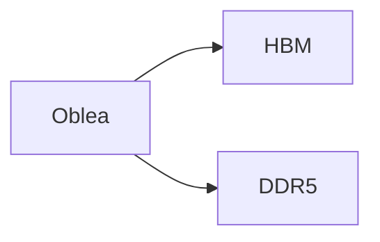

# Noticiario de Hardware — Pipeline de generación de video

Convierte un guion de texto (la respuesta de Claude al prompt
`~/Descargas/prompt_noticiario_hardware_final.md`, pegada en `input/guion.md`) en
un video con narración por voz neuronal (edge-tts o Kokoro en la GPU, a elección),
música de fondo con ducking y tarjetas de titular por bloque, más capítulos de
YouTube listos.

## Flujo del pipeline

```
guion.md  →  parse_script.py  →  bloques.json  (+ fuentes.md, la sección FUENTES separada)
bloques.json  →  generate_audio.py   →  audio/*.wav  + audio_manifest.json (duraciones)
bloques.json  →  generate_visuals.py → visuals/*.png (una tarjeta de titular por bloque)
audio_manifest.json + visuals/ + música →  assemble_video.py → output/video_final.mp4
```

`scripts/main.py` corre las 4 etapas en orden. En `output/` quedan
`video_final.mp4`, `fuentes.md` (la lista de fuentes, para la descripción del
video en YouTube), `visuales_pendientes.md` (imágenes que pidió el guion y no
existen) y los intermedios (`bloques.json`, `audio/`, `visuals/`, manifests),
que sirven para iterar. Con `output.clean_intermediates: true` o `--clean` se
borran al terminar.

### Iterar rápido

La voz de cada bloque queda en `cache/audio/<hash>.wav`, donde el hash depende
del texto del bloque y de los parámetros de voz. Cambiar una noticia solo
re-sintetiza esa noticia; cambiar la voz o la velocidad regenera todo. Además:

```bash
python scripts/main.py --skip-audio      # cambiaste colores/tarjetas: no toca el audio
python scripts/main.py --only-assemble   # cambiaste música, ducking o Ken Burns: solo re-arma el video
python scripts/main.py --clean           # borra intermedios al terminar
```

## Requisitos del sistema (Fedora/Debian)

```bash
sudo dnf install ffmpeg          # Fedora (de RPM Fusion, con soporte NVENC)
# o
sudo apt install ffmpeg          # Debian

sudo dnf install espeak-ng      # fonemizador que usa Kokoro para español

python3 -m venv .venv
source .venv/bin/activate
pip install -r requirements.lock.txt   # entorno idéntico al probado (o requirements.txt: solo los directos, pineados)
```

`requirements.txt` lleva versiones exactas a propósito: `edge-tts` persigue un
endpoint no oficial y `kokoro-onnx`/`onnxruntime-gpu` cambian de API; un
`pip install` con `>=` dentro de seis meses puede entregar un entorno que no corre.
Cuando actualices algo y funcione, regenera el lock: `pip freeze > requirements.lock.txt`.

### Voz (TTS)

Se elige en `config.yaml` → `tts.engine` (`edge` por defecto); `tts.fallback_engines`
es la cadena de respaldo: si un motor falla a mitad de la corrida, el resto del
guion sigue con el siguiente de la lista. Para comparar voces basta cambiar
`engine` y correr `python scripts/main.py --skip-visuals`: el caché de audio es por
motor, así que volver al anterior es instantáneo.

- **`edge`** (por defecto): voces neuronales de Microsoft vía `edge-tts`. Gratis,
  necesita internet. Voces chilenas: `es-CL-LorenzoNeural` (hombre) y `es-CL-CatalinaNeural`
  (mujer). Ojo: es un **cliente no oficial** del lector de Edge, sin SLA; ha dejado
  de funcionar varias veces cuando Microsoft cambió la autenticación. Por eso lleva
  respaldo, y si algún día se monetiza el canal conviene revisar sus términos de uso.
- **`kokoro`**: Kokoro-82M local en la GPU vía `kokoro-onnx` +
  `onnxruntime-gpu` (las libs CUDA 12 vienen por pip: `nvidia-*-cu12`). ~35× tiempo
  real en una RTX 4060 Ti: un episodio de 17 min se sintetiza en ~25 s. Voces en
  español: `em_alex`, `em_santa` (hombre), `ef_dora` (mujer). `kokoro_lang: es-419`
  da pronunciación latinoamericana (seseo); `es` suena a España. Modelo en `models/`:

  ```bash
  curl -L -o models/kokoro-v1.0.onnx https://github.com/thewh1teagle/kokoro-onnx/releases/download/model-files-v1.0/kokoro-v1.0.onnx
  curl -L -o models/voices-v1.0.bin https://github.com/thewh1teagle/kokoro-onnx/releases/download/model-files-v1.0/voices-v1.0.bin
  ```

  Los números y siglas los expande espeak-ng ("45,21" → "cuarenta y cinco coma
  veintiuno", "DDR5" → "de de erre cinco"), así que el guion puede venir con cifras.
- **`piper`**: local y offline, calidad más robótica. Último respaldo. Modelo:

  ```bash
  python -m piper.download_voices --download-dir models es_ES-davefx-medium
  ```

### GPU

`assemble_video.py` usa ffmpeg directo. Con `video.encoder: auto` detecta la GPU
NVIDIA (`h264_nvenc`) y si no hay cae a `libx264` por CPU. Un episodio de ~14 min
tarda ~3,5 min con `edge` (~2 min de descarga de voz + ~90 s de render) y ~2 min
con `kokoro`; con la voz en caché, ~90 s.

### Capítulos de YouTube y registro de música

Al final de cada corrida, `assemble_video.py` agrega a `output/fuentes.md`:

- **Capítulos** con timestamps acumulados desde `audio_manifest.json`, uno por
  noticia (las partes `_p1/_p2` y los `[IMAGEN]` que heredan titular caen en el
  mismo capítulo; capítulos < 10 s se absorben). Se pegan tal cual en la
  descripción del video.
- **Pista de música usada**, tramo y licencia. La licencia sale de
  `assets/music/licencias.yaml` (`"archivo.mp3": "texto"`); si no está registrada,
  queda anotado en mayúsculas para que no se te pase. `fuentes.md` es el archivo
  que sobrevive a la limpieza: ahí queda la constancia por si llega un reclamo de
  Content ID.

### Música

La música se mezcla con *ducking* (`music.ducking: true`): se comprime sola
mientras habla la voz y vuelve a subir en las pausas. `music.volume_db` es el
nivel sin voz. Con `ducking: false` vuelve a ser un volumen fijo.

### Diagramas (opcional)

Si un bloque `[DIAGRAMA: ...]` trae debajo un bloque ```` ```mermaid ```` y está
instalado el CLI de Mermaid (`npm i -g @mermaid-js/mermaid-cli`), el diagrama se
renderiza sobre la tarjeta. Si no, se usa una tarjeta de texto.

## Uso

1. Genera el guion en claude.ai con `prompt_noticiario_hardware.md` (con búsqueda
   web activada) y pega la respuesta completa en `input/guion.md`.
2. Pon una o varias pistas mp3 en `assets/music/` (pueden ser playlists largas de ~1h).
   En cada corrida se elige un mp3 al azar y, si es más largo que el video, arranca
   en un punto aleatorio. Para repetir un render fija `music.seed` en `config.yaml`.
3. (Opcional) Imágenes propias en `assets/images/`, nombradas `<slug>.png` (o
   jpg/webp). Después de una corrida, `output/visuales_pendientes.md` lista cada
   `[IMAGEN]`, `[DIAGRAMA]` y `[GRÁFICO]` del guion que no tiene archivo, con el
   nombre exacto que espera. Mientras no exista, se usa una tarjeta de texto
   (con `visuals.strict_assets: true` el pipeline aborta en vez de eso).
   Para el formato antiguo, `noticia_1.png` sirve para todas las partes
   `noticia_1_p1`, `noticia_1_p2`, ...
4. Ajusta `config.yaml` (nombre del canal, voz, colores, etc.).
5. Corre todo:

```bash
python scripts/main.py --script input/guion.md
```

Antes de generar la voz corre `scripts/lint_script.py` (dos segundos): etiquetas
mal formadas o con markdown encima, typos en etiquetas, URLs o `**` que hayan
quedado en el texto a narrar, corte de FUENTES sospechoso, bloques absurdamente
largos o cortos. Los errores abortan ahí, no en el minuto 3; `--no-lint` lo salta.

## Formato del guion

Tres formatos, detectados automáticamente:

**Con marcas visuales (el que emite el prompt actual, sección GUION PARA TTS):**
si el archivo trae una línea `GUION PARA TTS`, solo se usa lo que viene después
(lo anterior es la versión de lectura). Cada marca va sola en su línea:

```
[PLACA: RAM por las nubes]          nueva tarjeta de titular
Partamos por el fondo técnico...

[IMAGEN: Obleas de silicio de Samsung]   nuevo bloque, hereda el titular de la placa
Salen de las mismas fábricas...

[MANTENER]                          el texto sigue con el visual anterior
Es la misma torta...

[DIAGRAMA: Oblea repartida entre HBM y DDR5]

Fabricar HBM se come tres veces la oblea...

[GRÁFICO: Curva de precios DDR4]
...

[PAUSA]                             silencio de parsing.pause_sec al terminar el bloque anterior
```

Cada marca (salvo `[MANTENER]`) corta un bloque: un audio y un visual por bloque.
El visual lo decide el guion, no el pipeline. Las marcas nunca llegan a la voz
(hay un test para eso: `python -m unittest discover -s tests`).

**Con etiquetas editoriales (formato antiguo):** `[INTRO]`, `[NOTICIA 1: Titular]`,
`[CHILE: Titular]`, `[CIERRE]`. Bloques más largos que `parsing.max_block_words`
(220) se parten en sub-bloques con el mismo titular; la primera parte es una
tarjeta de titular y las siguientes una tarjeta "cita" (titular chico, extracto
grande), para que no se vean seis tarjetas idénticas seguidas.

**Sin etiquetas:** texto corrido; se agrupa en segmentos de ~130 palabras y el
titular de cada tarjeta es la primera oración del segmento.

En todos los casos:
- Todo lo que venga después de la **última** línea `FUENTES` (o `REFERENCIAS`) se
  saca del guion, no se narra y se guarda en `output/fuentes.md`. Una línea `---`
  sola no corta nada; solo se absorbe si va justo antes de `FUENTES`. El parser
  imprime cuántas palabras cortó (`[fuentes] se cortaron N palabras (X%)`).
- Se eliminan URLs, `**negritas**`, `#` y viñetas antes de narrar.

## Si falla la voz

`edge` necesita internet. Si falla a mitad de la corrida, el resto del guion se
sintetiza con `piper` (offline). Todo TTS se normaliza a 48 kHz mono al salir del
motor, así que mezclar motores no desincroniza el video. Si los dos motores
fallan en un bloque, ese bloque queda en silencio (duración estimada), el video
igual se genera y al final se lista qué bloques faltan; al volver a correr con
internet, solo se regeneran esos (el resto sale del caché).

## Estructura

```
noticiario-hardware/
├── README.md
├── requirements.txt          # paquetes directos, versiones exactas
├── requirements.lock.txt     # pip freeze completo
├── config.yaml
├── scripts/
│   ├── parse_script.py       # texto → bloques.json (+ fuentes.md)
│   ├── lint_script.py        # revisa guion + bloques antes de gastar tiempo en voz
│   ├── generate_audio.py     # bloques.json → audio/*.wav + manifest (kokoro / edge / piper, con caché)
│   ├── generate_visuals.py   # bloques.json → visuals/*.png (tarjetas, imágenes propias, Mermaid)
│   ├── assemble_video.py     # todo → output/video_final.mp4 (ffmpeg + NVENC, ducking)
│   └── main.py               # orquesta las 4 etapas (--skip-audio, --only-assemble, --clean)
├── tests/
│   └── test_parse_script.py  # python -m unittest discover -s tests
├── cache/audio/              # voz por bloque (hash de texto + voz); no va al repo
├── input/
│   └── guion.md
├── models/                   # kokoro-v1.0.onnx + voices-v1.0.bin, y la voz de Piper
├── assets/
│   ├── images/               # imágenes propias opcionales
│   └── music/                # pistas de música de fondo + licencias.yaml
└── output/                   # video_final.mp4 + fuentes.md
```

## TODOs

- [ ] `generate_visuals.py`: conseguir automáticamente las imágenes de
      `visuales_pendientes.md` (hoy se dejan a mano en `assets/images/`).
- [ ] `generate_audio.py`: backend ElevenLabs/OpenAI TTS.
- [ ] `assets/music/licencias.yaml`: llenar la licencia de cada pista.
- [ ] `assemble_video.py`: subtítulos automáticos con Whisper.
